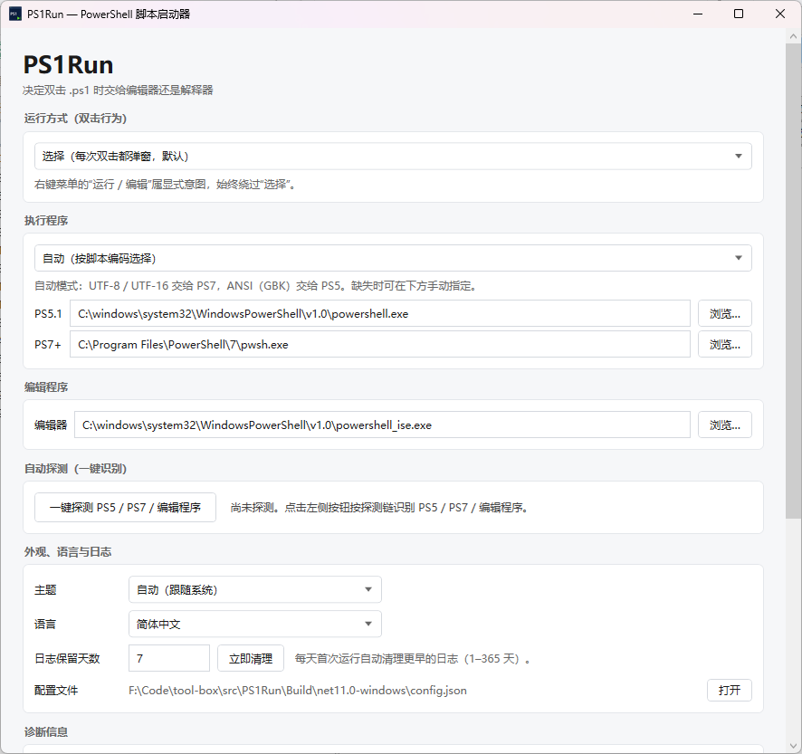
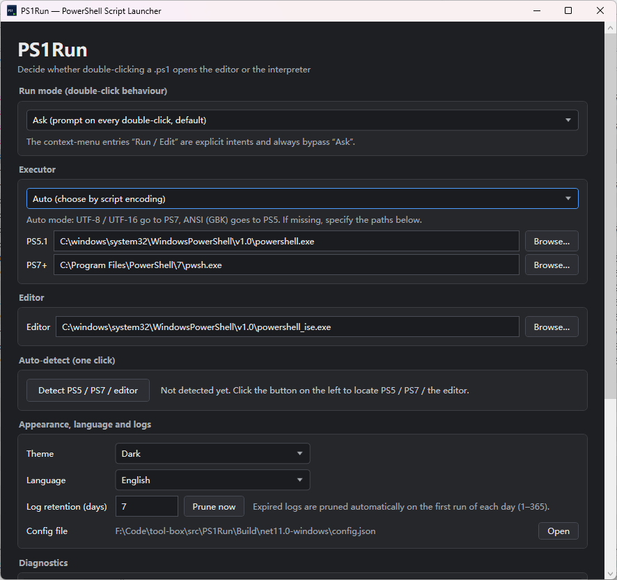
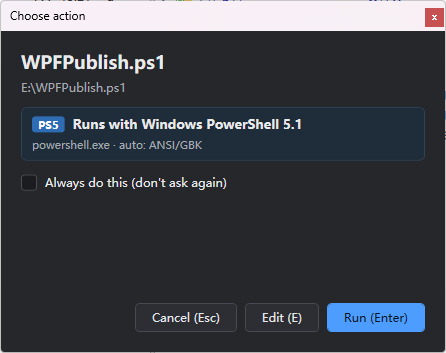

# PS1Run

> A small Windows desktop utility written in C# + WPF that takes over what happens when you double-click a `.ps1` file: run it, edit it, or ask you every time — and automatically pick between Windows PowerShell 5.1 and PowerShell 7 based on the script's encoding.

English | [简体中文](README.md)

---

## Table of Contents

- [The Problem](#the-problem)
- [Screenshots](#screenshots)
- [Features](#features)
- [Requirements](#requirements)
- [Getting Started](#getting-started)
- [Command-Line Arguments](#command-line-arguments)
- [Configuration and Directories](#configuration-and-directories)
- [Logging and Diagnostics](#logging-and-diagnostics)
- [Project Layout](#project-layout)
- [Development and Testing](#development-and-testing)
- [Known Limitations and Roadmap](#known-limitations-and-roadmap)
- [Documentation](#documentation)
- [Security Notes](#security-notes)

---

## The Problem

On Windows, double-clicking a `.ps1` file is awkward by default. It either opens in Notepad, or it runs in PowerShell with a console window that flashes and disappears. And if PowerShell 7 is installed, GBK-encoded scripts often end up running under `pwsh` and printing garbled Chinese text.

PS1Run takes that behaviour back:

- Double-click a `.ps1` → **run it**, **open it in your editor**, or **show a small picker and let you decide on the spot** (the default).
- When running, it inspects the script encoding: UTF-8 / UTF-16 goes to PowerShell 7, ANSI/GBK goes to Windows PowerShell 5.1, so non-ASCII output stays readable.
- The picker states up front whether **PS5 or PS7** will be used, plus the reason — you can confirm before anything executes.
- If no editor is found, it falls back step by step: custom path → common install locations → registry → `PATH` → Notepad. It never dead-ends.

Everything is launched on demand. There is **no background resident process**; the app dispatches and exits.

## Screenshots

**Main window (light · Simplified Chinese)** — run mode, interpreter, editor, one-click detection, and appearance/language/log settings all on a single page.



**Main window (dark · English)** — the same layout with the dark theme and the English language pack.



**Picker (light · Chinese)** — a UTF-8-with-BOM script is routed to PS7; interpreter, executable, and rationale are visible before anything runs.


**Picker (dark · English)** — an ANSI/GBK script is routed to PS5; the badge card and accent button stay legible on dark.



> The source screenshots live in the [`wiki/`](wiki) folder (`img-1.png` … `img-4.png`).

## Features

### File association

- Registers its own ProgId `Ps1Run.ps1` with three verbs:
  - `open` (double-click): dispatch according to your settings; show the picker in `Ask` mode;
  - `run` (context menu "Run"): force execution with an interpreter;
  - `edit` (context menu "Edit"): force the editor.
- Writes to `HKCU\Software\Classes` by default, so **no administrator rights are required**. Machine-level registration (`HKLM`) is optional, elevates through UAC, and reports clearly when it fails.
- Uninstall removes only the keys it created and de-registers itself from `OpenWithProgids`.
- Two guided entry points — "System 'Open with'…" and "Open default apps settings" — help you finish Windows' default-program switch. (`UserChoice` is hash-protected; the app never forces a rewrite.)

### Run modes

| Mode | Behaviour on double-click |
|---|---|
| **Ask every time** (default) | Shows the picker: Run / Edit / Cancel, with an optional "always do this" checkbox |
| **Run directly** | Immediately launches the selected interpreter |
| **Open in editor** | Immediately opens the detected editor |

The default is "Ask every time", because running an unknown script straight from a double-click is risky.

### Interpreter selection (PS5 / PS7)

- Three-state policy: `PowerShell 5` / `PowerShell 7` / `Auto` (default).
- In `Auto` mode the decision is driven by script encoding:

| Encoding | Selected |
|---|---|
| UTF-8 with BOM / UTF-8 without BOM / UTF-16 LE / UTF-16 BE | PowerShell 7 (`pwsh.exe`) |
| ANSI / GBK | Windows PowerShell 5.1 (`powershell.exe`) |
| Empty file / undetectable | Falls back to your preference, with a notice in the picker |

- Probe order:
  - PS5: `System32\WindowsPowerShell\v1.0` → `SysWOW64` → `App Paths` → `PATH`;
  - PS7: `PowerShellCore\InstalledVersions` registry → `App Paths` → `%ProgramFiles%\PowerShell\7` → `7-preview` → `PATH`.
- You can pin the PS5 / PS7 executable manually; a pinned path wins over detection and is still validated before use.
- Scripts run as `-NoProfile -File "<script>"` with the working directory set to the script's folder, so relative paths inside scripts behave as expected.

### Editor discovery

Five-level fallback: user-defined → common install paths (VS Code / Notepad++ / Sublime Text / PowerShell ISE / Notepad) → registry `App Paths` and `Uninstall` entries → `PATH` → system Notepad.

### UI, themes, and localization

- The main window is the single place to manage run mode, interpreter policy, editor, file association, theme, language, and logs.
- Themes: **Auto / Light / Dark**. Auto reads the system `AppsUseLightTheme` value and switches instantly.
- Localization: strings live in `lang\<code>.json`. Simplified Chinese and English ship with the app; any additional file dropped into `lang\` is discovered by the dropdown, and switching updates already-visible text immediately — no restart.
- The picker shows the script name, full path, the **PS5/PS7 badge with its rationale**, and an amber warning when a fallback or a missing executable is involved.

### Configuration and logging

- `config.json` stores program configuration (log retention days, theme, language). It is created on first run, written atomically, and backed up then rebuilt if corrupted.
- Logs roll daily into `log\yyyyMMdd.log`, with levels plus session and process IDs. Retention is configurable, and expired files are pruned on the first run of each day.
- The UI exposes "Open log folder", "View today's log", "Copy recent logs", and "Clean up now" for easy issue reporting.

## Requirements

| Item | Requirement |
|---|---|
| OS | Windows 10 / Windows 11 (x64) |
| Runtime | Either **.NET Framework 4.8** (bundled with Windows 10 1809+) or the **.NET 11 Desktop Runtime** |
| Build environment | .NET SDK 11.0+ (dual-target builds also need the .NET Framework 4.8 targeting pack) |
| PowerShell | At least Windows PowerShell 5.1 (built into Windows); PowerShell 7 optional |

Two sets of artifacts are produced — pick whichever matches what the target machine has installed:

- `Build\net48\Ps1Run.exe` — depends on .NET Framework 4.8, best compatibility;
- `Build\net11.0-windows\Ps1Run.exe` — depends on the .NET 11 Desktop Runtime.

## Getting Started

### Build

```powershell
# Dual-target build (net48 + net11.0-windows)
dotnet build Ps1Run.slnx

# Or use the scripts
.\scripts\build-all.ps1                                # Debug, both targets
.\scripts\build-all.ps1 -Configuration Release -Test   # Release + run tests
.\scripts\build-net48.ps1                              # net48 only
.\scripts\build-net11.ps1                              # net11 only
```

All output goes to `Build\<TFM>\`.

### Run

```powershell
# Open the main window
.\scripts\run.ps1

# Run the net11 / Release artifact
.\scripts\run.ps1 -Framework Net11 -Configuration Release

# Build first, then force-run a specific script
.\scripts\run.ps1 -Build -Intent Run -ScriptPath "D:\scripts\demo.ps1"

# Pass arguments through verbatim
.\scripts\run.ps1 -Arguments @("--open", "D:\scripts\a.ps1")
```

You can also just double-click `Build\net48\Ps1Run.exe`.

### First-run checklist

1. Open the main window and confirm that PS5 / PS7 were detected under "Interpreter" (use "Auto detect" to re-scan).
2. Click "Register" for per-user file association. Use "Register for all users" only if you want machine-wide behavior, and confirm the UAC prompt.
3. Double-click any `.ps1` to verify the picker appears; it shows which interpreter will be used.
4. To undo, click "Unregister", or change the default app back via "Open default apps settings".

## Command-Line Arguments

| Argument | Description |
|---|---|
| *(none)* | Show the main window |
| `--open <script>` | Dispatch according to settings; shows the picker when run mode is "Ask" (used by the `open` verb) |
| `--run <script>` | Force execution with an interpreter, bypassing the run-mode setting |
| `--edit <script>` | Force the editor |
| `--ask <script>` | Force the picker |
| `--settings` | Open the settings UI directly |
| `--register-machine` | Perform machine-level registration in an elevated process (internal) |
| `--unregister-machine` | Perform machine-level unregistration in an elevated process (internal) |
| `--help`, `-h`, `-?` | Show help |
| `--` | Treat everything after it as a literal path, supporting filenames that start with `-` |

Precedence: `--run` / `--edit` > `--ask` > `--open` > bare path > no arguments. Passing `--run` and `--edit` together is reported as a conflict.

Exit codes:

| Code | Meaning |
|---|---|
| `0` | Success, or cancelled by the user |
| `1` | Unexpected internal error |
| `2` | Invalid command-line arguments |
| `3` | Script file not found |
| `4` | No interactive desktop, window creation failed, or target program unavailable |

## Configuration and Directories

The app is portable by default: everything lives in the application root, i.e. the folder containing `Ps1Run.exe`.

| Path | Purpose |
|---|---|
| `config.json` | Program configuration: log retention days, theme, language |
| `lang\zh-cn.json` | Simplified Chinese language pack (generated on first run) |
| `lang\en-us.json` | English language pack (shipped with the app) |
| `log\yyyyMMdd.log` | Daily rolling runtime log |
| `%APPDATA%\Ps1Run\settings.json` | Behaviour preferences: run mode, interpreter policy, custom paths |

> If the application root is not writable (typically installed under `Program Files` without elevation), `config.json`, `lang\`, and `log\` **all** fall back together to `%APPDATA%\Ps1Run\`, with a WARN entry in the log. Keeping them on one writable root avoids split-brain configuration.

### config.json

```json
{
  "LogDays": 7,
  "Theme": "Auto",
  "Language": "zh-cn"
}
```

| Field | Value | Notes |
|---|---|---|
| `LogDays` | 1–365, default `7` | Log retention in days; out-of-range values are normalized back to 7 |
| `Theme` | `Auto` / `Light` / `Dark` | `Auto` follows the system theme |
| `Language` | Language code, e.g. `zh-cn`, `en-us` | Maps to `lang\<code>.json` |

### Custom language packs

Create a file such as `lang\ja-jp.json` with key/value pairs, and the dropdown will pick it up automatically:

```json
{
  "Button.Save": "Save settings",
  "Button.Browse": "Browse…"
}
```

- Missing keys fall back in order: current language → built-in Chinese → the key name itself, so nothing renders blank.
- The complete key set is available in `lang\zh-cn.json`. Translate only the keys you need; the rest fall back automatically.
- UI text binds through `{loc:T Key}` and refreshes immediately when the language changes.
- XAML also carries a design-time helper, `d:DesignText.Text="Save settings"`: it only supplies placeholder text inside the designer, is skipped entirely at runtime, and real text still comes from the language pack.

## Logging and Diagnostics

- Location: `log\yyyyMMdd.log` (retention controlled by `LogDays` in `config.json`).
- Levels: `DEBUG` / `INFO` / `WARN` / `ERROR`. Each line carries `[s:sessionId]` and `[p:processId]`, which makes multiple double-click launches easy to tell apart.
- What gets recorded: startup arguments and exe path, encoding detection result, chosen interpreter and probe source, target process PID, exit code; cancellations, argument errors, missing files, process launch failures (including Win32 error codes), corrupted settings/config, association registration and elevation, and unhandled exceptions.
- Cleanup: expired logs are deleted on the **first** run of each day, with a "daily cleanup" entry written. Later launches on the same day skip it.
- UI entry points: "Open log folder", "View today's log", "Copy recent logs" (last 150 lines), "Clean up now".
- Logging failures are always swallowed — they never affect the dispatch path.

## Project Layout

```
Ps1Run/
├─ Ps1Run.slnx                     # Solution (three projects)
├─ Directory.Build.props           # Dual target: net48;net11.0-windows, output to Build\<TFM>\
├─ Ps1Run.Core/                    # UI-free core (unit-testable)
│  ├─ Associations/                #   ProgId, register/unregister, elevation, UserChoice detection
│  ├─ Configuration/               #   AppPaths, AppConfig, ConfigStore
│  ├─ Dispatch/                    #   argument parsing, dispatcher, picker contract, exit codes
│  ├─ Editors/                     #   editor discovery and registry anchors
│  ├─ Infrastructure/              #   logging, process launch, path search, P/Invoke, minimal JSON
│  ├─ Localization/                #   built-in Chinese strings, language directory scanning
│  ├─ PowerShell/                  #   encoding detection, PS5/PS7 probing
│  └─ Settings/                    #   preference model and persistence
├─ Ps1Run.App/                     # WPF shell: windows, bindings, themes, i18n
│  ├─ Themes/                      #   Light.xaml / Dark.xaml
│  ├─ Localization/                #   LocalizationManager, {loc:T}, design-time text
│  ├─ Views/ ViewModels/ Services/ #   main window, picker, placement, theme manager
│  └─ lang/en-us.json              #   English pack shipped with the app
├─ Ps1Run.Core.Tests/              # Dependency-free console test project (net11 single target)
├─ scripts/                        # Build and run scripts
├─ wiki/                           # Requirements, feature matrix, architecture, deep dives, progress
└─ Build/                          # Build output (net48 / net11.0-windows)
```

Design rule: all testable logic lives in `Ps1Run.Core`; `Ps1Run.App` only handles windows and process lifetime.

## Development and Testing

```powershell
# Build
dotnet build Ps1Run.slnx

# Unit tests (7 groups)
dotnet run --project Ps1Run.Core.Tests\Ps1Run.Core.Tests.csproj --no-build
```

The seven test groups:

| Group | Coverage |
|---|---|
| Encoding detection | Six input shapes (BOM / no BOM / UTF-16 / ANSI / empty / invalid) |
| Argument parsing | Verb precedence, conflicts, literal-path mode |
| Interpreter probing | PS5/PS7 probe chains and fallback order |
| Settings persistence | JSON round-trip, defaults on missing values, backup-and-rebuild on corruption |
| Log write and retention | Level/session format, reading recent lines, retention policy, daily cleanup |
| Program configuration | `config.json` generation, range normalization, corruption recovery |
| Localization resources | Language directory scan, default pack generation, missing-key fallback |

Tests run against `net11.0-windows` only, to avoid doubling the matrix. The `net48` path is covered by the dual-target build plus manual startup verification.

## Known Limitations and Roadmap

- **System-level acceptance is still manual**: registry changes, double-click dispatch, and multi-monitor picker placement need a real desktop session and are not automated.
- **Uninstall rollback is incomplete**: unregistration clears the ProgId and `OpenWithProgids` entries it created, but does not restore the previous default value of `.ps1`, and there is no `association-backup.json` snapshot.
- **Store edition of PS7 is not probed**: PowerShell 7 installed under `%ProgramFiles%\WindowsApps` is not yet part of the probe chain.
- **No prompt when every editor fails**: the chain ends at Notepad instead of asking you to pick one (you can still browse for an editor manually in the main window).
- **System theme changes are not watched live**: `Auto` is resolved at startup (or when you change the setting), so a mid-session theme change requires a restart or re-selecting the theme.
- Remaining design items that are not implemented yet (registry write mutex, a "re-run with the other version" entry after a fallback, etc.) are tracked as D16–D21 in [wiki/04-progress.md](wiki/04-progress.md).

## Documentation

| Document | Contents |
|---|---|
| [wiki/index.md](wiki/index.md) | Documentation overview and current status (start here) |
| [wiki/01-requirements.md](wiki/01-requirements.md) | Requirements R1–R9 and per-item acceptance criteria |
| [wiki/02-feature-matrix.md](wiki/02-feature-matrix.md) | 45 feature points × implementation site × status × acceptance notes (source of truth for status) |
| [wiki/03-project-structure.md](wiki/03-project-structure.md) | Directory plan, project split, build conventions |
| [wiki/04-progress.md](wiki/04-progress.md) | Milestones, completion, gap list (source of truth for progress) |
| [wiki/05-architecture-flows.md](wiki/05-architecture-flows.md) | Full call chain after a double-click, argument protocol, process lifetime |
| [wiki/06-tech-file-association.md](wiki/06-tech-file-association.md) | ProgId design, UserChoice hash wall, HKCU/HKLM permissions, uninstall strategy |
| [wiki/07-tech-powershell-encoding.md](wiki/07-tech-powershell-encoding.md) | PS5/PS7 probe order and encoding decision table |
| [wiki/08-tech-editor-discovery.md](wiki/08-tech-editor-discovery.md) | Editor discovery sources and fallback chain |
| [wiki/09-eval-dual-target-framework.md](wiki/09-eval-dual-target-framework.md) | Dual-target framework evaluation with measured data |
| [wiki/10-eval-background-residency.md](wiki/10-eval-background-residency.md) | Whether background residency is needed — the conclusion |
| [wiki/11-build-and-dev-guide.md](wiki/11-build-and-dev-guide.md) | Build, run, and troubleshooting guide |
| [wiki/12-appendix-registry-map.md](wiki/12-appendix-registry-map.md) | Registry snapshot of association-related keys on the test machine |

## Security Notes

- PS1Run only returns the double-click decision to you. It does **not** change the PowerShell execution policy and does not inspect script contents.
- Double-clicking an untrusted `.ps1` is still risky. The default "Ask every time" mode exists to give you a one-second confirmation before anything runs.
- Per-user association writes to `HKCU` and needs no elevation. Machine-level registration requests administrator rights — make sure the UAC prompt originates from this program.
- Logs contain script paths and launch arguments. Review them before sharing if they may include sensitive information.
