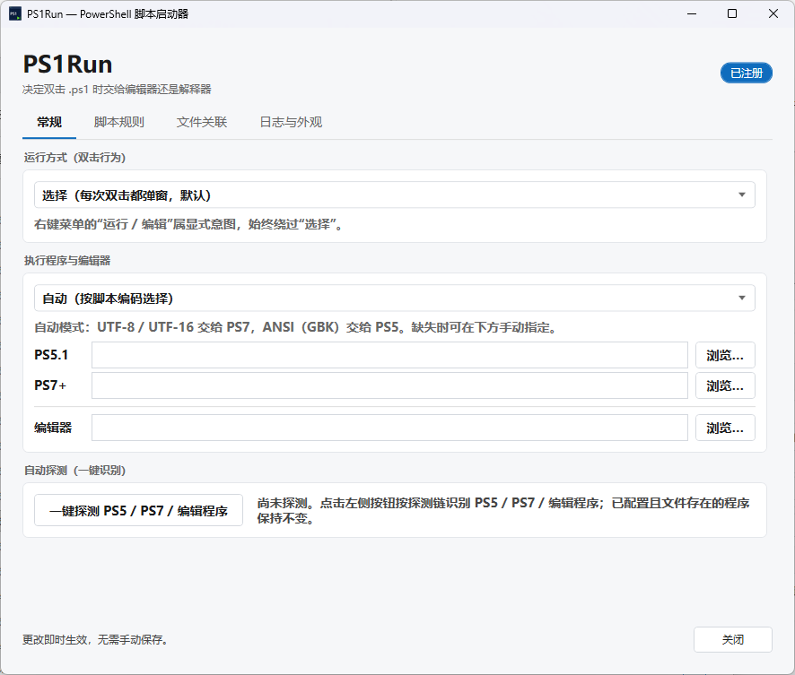
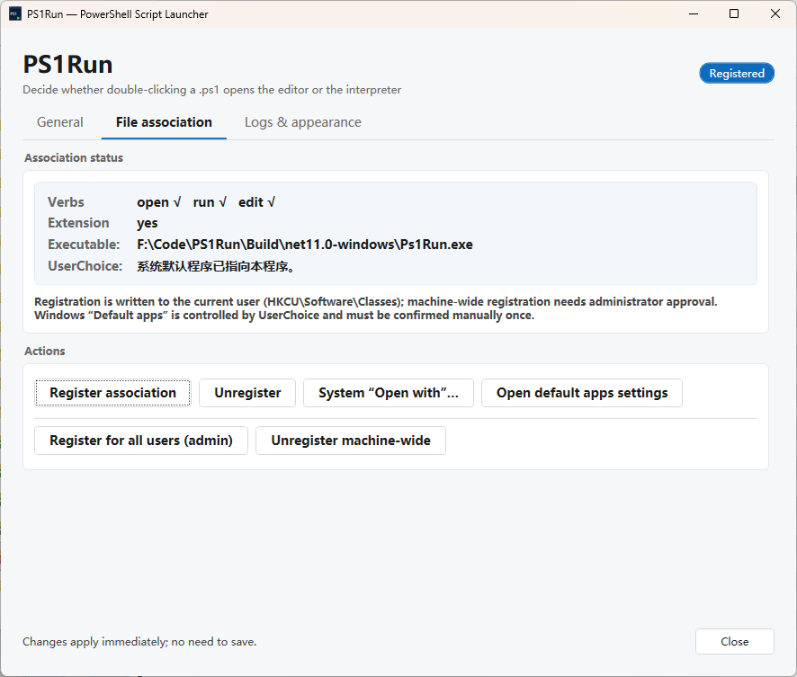
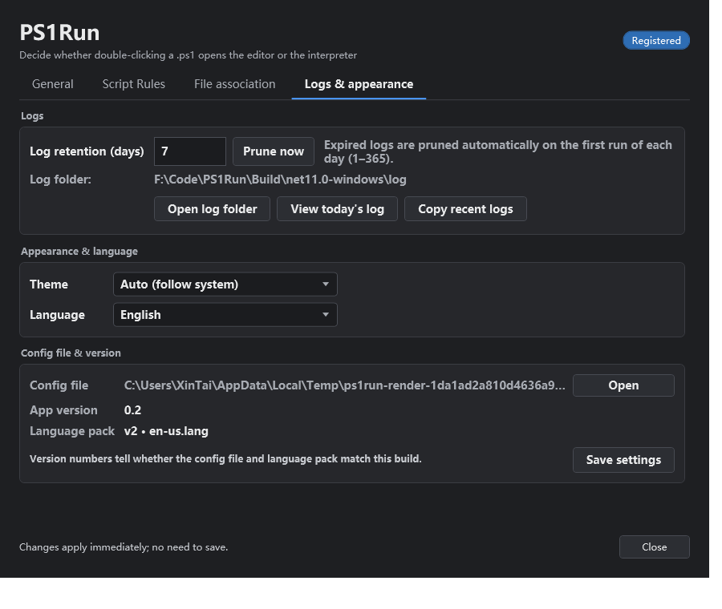
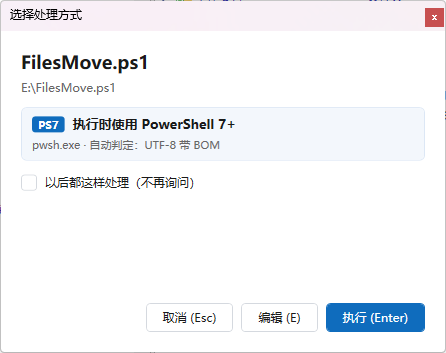
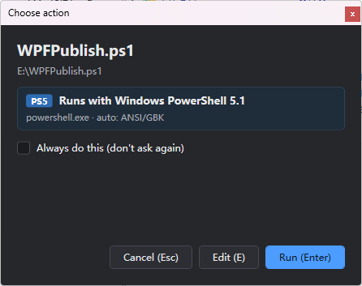
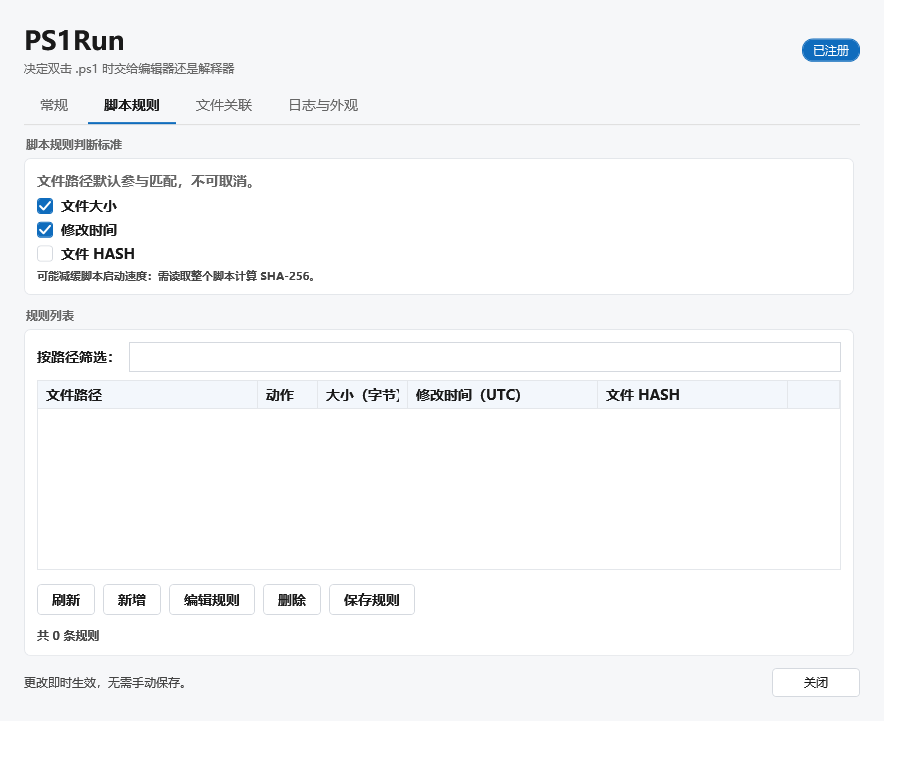

# PS1Run

> 一个用 C# + WPF 编写的 Windows 桌面小工具：接管 `.ps1` 文件的双击行为，让你自己决定「执行 / 编辑 / 每次问我」，并在 PowerShell 5.1 与 PowerShell 7 之间按脚本编码自动挑选解释器。

> A small Windows desktop utility written in C# + WPF that takes over what happens when you double-click a `.ps1` file: run it, edit it, or ask you every time — and automatically pick between Windows PowerShell 5.1 and PowerShell 7 based on the script's encoding.

[English](README-en.md) | 简体中文 | [变更说明](CHANGELOG.md)

---

## 目录

- [PS1Run](#ps1run)
  - [目录](#目录)
  - [它解决什么问题](#它解决什么问题)
  - [界面预览](#界面预览)
  - [功能特性](#功能特性)
    - [文件关联](#文件关联)
    - [运行方式](#运行方式)
    - [解释器选择（PS5 / PS7）](#解释器选择ps5--ps7)
    - [编辑器探测](#编辑器探测)
    - [界面、主题与多语言](#界面主题与多语言)
    - [配置与日志](#配置与日志)
  - [系统要求](#系统要求)
  - [快速开始](#快速开始)
    - [构建](#构建)
    - [运行](#运行)
    - [首次使用建议](#首次使用建议)
  - [命令行参数](#命令行参数)
  - [配置文件与目录](#配置文件与目录)
    - [config.cfg](#configcfg)
    - [rule.txt](#ruletxt)
    - [自定义语言包](#自定义语言包)
  - [日志与诊断](#日志与诊断)
  - [项目结构](#项目结构)
  - [开发与测试](#开发与测试)
  - [已知限制与后续计划](#已知限制与后续计划)
  - [文档](#文档)
  - [安全提示](#安全提示)

---

## 它解决什么问题

Windows 上双击 `.ps1` 的默认行为很别扭：要么被记事本打开，要么被 PowerShell 直接执行且窗口一闪而过；装了 PowerShell 7 之后，还经常出现「脚本是 GBK 编码，却被 pwsh 执行导致中文乱码」。

PS1Run 把这条链路收回来：

- 双击 `.ps1` → 按你的设置**执行**、**打开编辑器**，或**弹一个小窗让你当场选**（默认）。
- 执行时自动判断脚本编码：UTF-8 / UTF-16 走 PowerShell 7，ANSI/GBK 走 Windows PowerShell 5.1，避免中文乱码。
- 弹窗里会直接标出「这次会用 PS5 还是 PS7」以及判断依据，点执行之前就能确认。
- 找不到编辑器时按「自定义 → 常见安装路径 → 注册表 → PATH → 记事本」逐级回退，不会卡住。

全程按需启动，**没有后台常驻进程**，分发完就退出。

> 警告：
> Directory Opus 默认无法双击调用PS1Run，因为其 
> 
> **自带独立的文件类型双击规则，会优先拦截双击动作，不调用 Windows 系统默认关联（ShellExecute）**。
> 

## 界面预览

**主界面 · 常规（浅色 · 简体中文）**：三个页签中的第一页，集中展示运行方式、执行程序与编辑器（PS5.1 / PS7+ / 编辑器路径）以及「一键探测」；标题栏常驻关联徽标。



**主界面 · 文件关联（浅色 · English）**：关联状态卡片与注册操作；用户级注册无需提权，机器级注册会走 UAC。



**主界面 · 日志与外观（深色 · English）**：日志保留、外观与语言、配置文件与版本；语言包版本号以 `v2 · en-us.lang` 形式显示。



标题栏的关联徽标在三个页签中始终可见；当中文语言包缺少版本号时，「日志与外观」页签还会挂一个「！」徽标，并在页内与选择窗显示红字提醒。

**选择窗（浅色 · 简体中文）**：UTF-8 带 BOM 的脚本判为 PS7，执行前就能看到解释器、可执行文件与判定依据。



**选择窗（深色 · English）**：ANSI/GBK 脚本判为 PS5，深色主题下标识卡片与强调按钮依然清晰。



> 截图源文件存放在 [`wiki/`](wiki) 目录：`home-1.png` ~ `home-3.png`、`picker-1.png` ~ `picker-2.png`。

## 功能特性

### 文件关联

- 注册独立的 ProgId `Ps1Run.ps1`，提供三个动词：
  - `open`（双击）：按设置分发，`Ask` 模式下弹选择窗；
  - `run`（右键「运行」）：强制以解释器执行；
  - `edit`（右键「编辑」）：强制打开编辑器。
- 默认写入 `HKCU\Software\Classes`，**不需要管理员权限**；可选机器级注册（`HKLM`），会通过 UAC 提权，失败时明确提示原因。
- 注销时只清理自己写入的项，并在 `OpenWithProgids` 中移除自己的登记。
- 提供「系统『打开方式』」「打开默认应用设置」两个入口，引导你完成 Windows 的默认程序切换（`UserChoice` 有哈希校验，程序不强行改写）。

### 运行方式

| 模式 | 双击时的行为 |
|---|---|
| **每次询问（默认）** | 弹出选择窗：执行 / 编辑 / 取消，可勾选「以后都这样处理」 |
| **直接执行** | 立刻用选定的解释器运行 |
| **打开编辑器** | 立刻用探测到的编辑器打开 |

默认取「每次询问」：双击来源不明的脚本直接执行有风险。

### 解释器选择（PS5 / PS7）

- 三态策略：`PowerShell 5` / `PowerShell 7` / `自动`（默认）。
- 自动模式按脚本编码判定：

| 编码 | 选用 |
|---|---|
| UTF-8 带 BOM / UTF-8 无 BOM / UTF-16 LE / UTF-16 BE | PowerShell 7（`pwsh.exe`） |
| ANSI / GBK | Windows PowerShell 5.1（`powershell.exe`） |
| 空文件 / 无法判定 | 按偏好回退，并在弹窗中提示 |

- 探测顺序：
  - PS5：`System32\WindowsPowerShell\v1.0` → `SysWOW64` → `App Paths` → `PATH`；
  - PS7：`PowerShellCore\InstalledVersions` 注册表 → `App Paths` → `%ProgramFiles%\PowerShell\7` → `7-preview` → `PATH`。
- 允许手动指定 PS5 / PS7 的 exe 路径；指定后优先级最高，使用前仍会校验文件是否存在。
- 执行命令为 `-NoProfile -File "<脚本>"`，工作目录设为脚本所在目录，脚本里的相对路径行为符合直觉。

### 编辑器探测

五级回退：用户自定义 → 常见安装路径（VS Code / Notepad++ / Sublime Text / PowerShell ISE / 记事本）→ 注册表 `App Paths` 与 `Uninstall` → `PATH` → 系统记事本兜底。

### 界面、主题与多语言

- 主界面集中管理：运行方式、解释器策略、编辑器、文件关联、主题、语言、日志。
- 主题：**自动 / 浅色 / 深色**。自动模式读取系统 `AppsUseLightTheme` 决定深浅色，切换即时生效。
- 多语言：文案存于 `lang\<code>.lang`，内置简体中文与英文；下拉框会自动发现 `lang` 目录下的新语言文件，切换后已显示的文字立即刷新，无需重启。
- 选择窗显示脚本名、完整路径、**PS5/PS7 标识与判定依据**，以及降级或缺失时的橙色提醒；配置的执行程序/编辑器路径不存在（或完全探测不到编辑器）时会额外显示红字提示。窗口打开即在屏幕中央，不闪现。

### 脚本规则（仅此脚本）

选择窗新增「以后都这样处理（仅此脚本）」：勾选后按当前的判断标准把脚本写入 `rule.txt`，下次双击同一脚本在「选择」模式下直接按记录的动作执行 / 编辑，不再弹窗。它与「以后都这样处理（不再询问）」互斥；`--ask` 始终强制弹窗，不受规则影响。

- 文件路径**默认且始终参与匹配**，不可取消。
- 可勾选的判断标准在「脚本规则」页顶部：`文件大小`（默认开）、`修改时间`（默认开）、`文件 HASH`（默认关，需读取整个脚本计算 SHA-256，可能减缓启动速度）。
- 匹配顺序为路径 → 大小 → 修改时间 → HASH，短路判断；HASH 只在前面都通过时才计算。
- 规则数据与判断标准变更后的指纹重写都写入同一份 `rule.txt`，页面保存后无需重启即可生效。

### 脚本规则（仅此脚本）

选择窗新增「以后都这样处理（仅此脚本）」：勾选后按当前的判断标准把脚本写入 `rule.txt`，下次双击同一脚本在「选择」模式下直接按记录的动作执行 / 编辑，不再弹窗。它与「以后都这样处理（不再询问）」互斥；`--ask` 始终强制弹窗，不受规则影响。

- 文件路径**默认且始终参与匹配**，不可取消。
- 可勾选的判断标准在「脚本规则」页顶部：`文件大小`（默认开）、`修改时间`（默认开）、`文件 HASH`（默认关，需读取整个脚本计算 SHA-256，可能减缓启动速度）。
- 匹配顺序为路径 → 大小 → 修改时间 → HASH，短路判断；HASH 只在前面都通过时才计算。
- 规则数据与判断标准变更后的指纹重写都写入同一份 `rule.txt`，页面保存后无需重启即可生效。

### 脚本规则（仅此脚本）

选择窗新增「以后都这样处理（仅此脚本）」：勾选后按当前的判断标准把脚本写入 `rule.txt`，下次双击同一脚本在「选择」模式下直接按记录的动作执行 / 编辑，不再弹窗。它与「以后都这样处理（不再询问）」互斥；`--ask` 始终强制弹窗，不受规则影响。

- 文件路径**默认且始终参与匹配**，不可取消。
- 可勾选的判断标准在「脚本规则」页顶部：`文件大小`（默认开）、`修改时间`（默认开）、`文件 HASH`（默认关，需读取整个脚本计算 SHA-256，可能减缓启动速度）。
- 匹配顺序为路径 → 大小 → 修改时间 → HASH，短路判断；HASH 只在前面都通过时才计算。
- 规则数据与判断标准变更后的指纹重写都写入同一份 `rule.txt`，页面保存后无需重启即可生效。

**脚本规则页（浅色 · 简体中文）**：顶部判断标准 + 规则列表 + 增删改查按钮。



### 配置与日志

- `config.cfg` 是唯一配置文件，保存程序配置（日志天数、主题、语言）与运行设置（运行方式、解释器策略、自定义路径、规则判断标准），首次运行自动生成，原子写入，损坏时备份重建。
- `rule.txt` 保存「以后都这样处理（仅此脚本）」产生的规则，5 列纯文本，可在「脚本规则」页增删改查。
- 日志按天写入 `log\yyyyMMdd.log`，四级级别、带会话 ID 与进程 ID；保留天数可配，每天第一次运行自动清理过期日志。
- 界面提供「打开日志目录」「查看当日日志」「复制最近日志」「立即清理」，方便反馈问题。

## 系统要求

| 项 | 要求 |
|---|---|
| 操作系统 | Windows 10 / Windows 11（x64） |
| 运行时 | 二选一：**.NET Framework 4.8**（Windows 10 1809+ 自带）或 **.NET 11 Desktop Runtime** |
| 构建环境 | .NET SDK 11.0+（双目标构建还需 .NET Framework 4.8  targeting pack） |
| PowerShell | 至少 Windows PowerShell 5.1（系统自带）；PowerShell 7 可选 |

产物分两份，按机器上装了什么选一份即可：

- `Build\net48\Ps1Run.exe` —— 依赖 .NET Framework 4.8，兼容性最好；
- `Build\net11.0-windows\Ps1Run.exe` —— 依赖 .NET 11 桌面运行时。

## 快速开始

### 构建

```powershell
# 双目标构建（net48 + net11.0-windows）
dotnet build Ps1Run.slnx

# 或使用脚本
.\scripts\build-all.ps1                 # Debug，双目标
.\scripts\build-all.ps1 -Configuration Release -Test   # Release + 跑单测
.\scripts\build-net48.ps1               # 只构建 net48
.\scripts\build-net11.ps1               # 只构建 net11
```

产物统一输出到 `Build\<TFM>\`。

### 运行

```powershell
# 打开主界面
.\scripts\run.ps1

# 运行 net11 / Release 产物
.\scripts\run.ps1 -Framework Net11 -Configuration Release

# 先构建再强制运行指定脚本
.\scripts\run.ps1 -Build -Intent Run -ScriptPath "D:\scripts\中文 脚本.ps1"

# 原样传递参数
.\scripts\run.ps1 -Arguments @("--open", "D:\scripts\a.ps1")
```

也可以直接双击 `Build\net48\Ps1Run.exe`。

### 首次使用建议

1. 启动主界面，在「常规 → 执行程序与编辑器」确认 PS5 / PS7 与编辑器路径；点「一键探测 PS5 / PS7 / 编辑程序」可补空缺，且不会覆盖已配置且文件仍存在的路径。
2. 点「注册」完成用户级文件关联；如需所有用户生效，再点「机器级注册」并确认 UAC。
3. 双击任意 `.ps1` 验证弹窗是否出现，选择窗里会显示本次将使用的解释器。
4. 想撤销时点「注销」，或在「打开默认应用设置」里改回其它程序。

## 命令行参数

| 参数 | 说明 |
|---|---|
| 无参数 | 显示主界面 |
| `--open <脚本>` | 按设置分发；运行方式为「每次询问」时弹选择窗（文件关联的 `open` 动词使用） |
| `--run <脚本>` | 强制以解释器执行，绕过运行方式设置 |
| `--edit <脚本>` | 强制打开编辑器 |
| `--ask <脚本>` | 强制弹选择窗 |
| `--settings` | 直接打开设置界面 |
| `--register-machine` | 在已提权进程中执行机器级注册（内部使用） |
| `--unregister-machine` | 在已提权进程中执行机器级注销（内部使用） |
| `--help`、`-h`、`-?` | 显示帮助 |
| `--` | 其后所有参数按字面路径处理，兼容以 `-` 开头的文件名 |

参数优先级：`--run` / `--edit` > `--ask` > `--open` > 裸参数 > 无参数。`--run` 与 `--edit` 同时出现视为参数冲突。

退出码：

| 退出码 | 含义 |
|---|---|
| `0` | 成功，或用户主动取消 |
| `1` | 未预期的内部错误 |
| `2` | 命令行参数非法 |
| `3` | 脚本文件不存在 |
| `4` | 无人交互桌面、窗口创建失败或目标程序不可用 |

## 配置文件与目录

默认采用绿色形态，所有文件都在软件根目录（即 `Ps1Run.exe` 所在目录）：

| 路径 | 用途 |
|---|---|
| `config.cfg` | 唯一配置文件：程序配置（日志保留天数、主题、语言）+ 行为设置（运行方式、解释器策略、自定义路径、规则标准）+ schema 版本号 |
| `lang\zh-cn.lang` | 简体中文语言包（随程序附带；缺版本号或版本较旧时启动会按内置文案重建） |
| `lang\en-us.lang` | 英文语言包（随程序附带，不会被自动覆盖） |
| `rule.txt` | 「仅此脚本」规则列表，5 列：`文件路径|动作|文件大小|修改时间|文件HASH` |
| `log\yyyyMMdd.log` | 按天滚动的运行日志 |

> **破坏性更新**：旧 `config.json`、`%APPDATA%\Ps1Run\settings.json` 与 `lang\*.json` 均不再读取、不再迁移、不再删除。请按下面的新格式手工替换；残留文件不会影响运行，但也不会生效。

> 如果软件根目录不可写（典型：装在 `Program Files` 且未提权），`config.cfg`、`rule.txt`、`lang\`、`log\` 会**一起**退化到 `%APPDATA%\Ps1Run\`，并写一条 WARN 日志，保证它们始终在同一个可写根下。

### config.cfg

```text
Version: 2,
RunMode: "Ask",
PowerShellPolicy: "Auto",
CustomPs5Path: "",
CustomPs7Path: "",
CustomEditorPath: "",
LogDays: 7,
Theme: "Auto",
Language: "zh-cn",
RuleMatchSize: 1,
RuleMatchModifiedTime: 1,
RuleMatchHash: 0,
```

| 字段 | 取值 | 说明 |
|---|---|---|
| `Version` | 当前为 `2` | 配置格式版本；与语言包共用同一套键值文本格式。旧 JSON 配置不会读取 |
| `RunMode` | `Run` / `Edit` / `Ask` | 双击 `.ps1` 的行为；`Ask` 每次弹窗（默认） |
| `PowerShellPolicy` | `Ps5` / `Ps7` / `Auto` | 解释器策略；`Auto` 按脚本编码判定 |
| `CustomPs5Path` / `CustomPs7Path` / `CustomEditorPath` | 可执行文件路径，空串表示未指定 | 为空时按探测链自动查找 |
| `LogDays` | 1–365，默认 `7` | 日志保留天数；越界会被收敛回 7 |
| `Theme` | `Auto` / `Light` / `Dark` | `Auto` 跟随系统主题 |
| `Language` | 语言代码，如 `zh-cn`、`en-us` | 对应 `lang\<code>.lang` |
| `RuleMatchSize` / `RuleMatchModifiedTime` / `RuleMatchHash` | `1` / `0` | 规则判断标准；文件路径始终匹配，HASH 默认 `0` |

### 自定义语言包

在 `lang\` 下新建 `ja-jp.lang` 之类的纯文本文件，键值成对即可，下拉框会自动出现该语言：

```text
Version: 2,
Button.Save: "保存设置",
Button.Browse: "浏览…",
```

- `Version` 是语言包版本号（当前为 `2`），加载时不会当作界面文案。**缺少它或低于程序期望版本时**：「日志与外观」页签挂「！」徽标、页内出现红字提醒，运行时选择窗也会用红字说明"部分文字可能显示为中文"（语言包照常加载，缺键仍回退中文）。
- 修复方式：点「重新生成 zh-cn.lang」按内置文案重建中文包；其他语言包不会被程序覆盖，需自行补上 `Version` 或更新文案。旧 `.json` 语言包只会被忽略并写一条 WARN 日志。
- 缺失的键会逐级回退：当前语言 → 内置中文 → 键名本身，不会因为漏翻而出现空白。
- 键名全集可在 `lang\zh-cn.lang` 中查到，按需增删；只需覆盖想翻译的键，其余留空即可回退。
- `rule.txt` 每行格式为 `文件路径|动作|文件大小|修改时间|文件HASH`，动作取 `Run` / `Edit`；关闭的标准写 `0`，修改时间为 UTC ISO 8601，HASH 为小写 SHA-256。
- 界面文案通过 `{loc:T Key}` 绑定，切换语言后立即生效。
- XAML 中另有设计期辅助属性 `d:DesignText.Text="保存设置"`：只在设计器里显示占位文本，运行时完全跳过，实际文案仍来自语言包。

## 日志与诊断

- 位置：`log\yyyyMMdd.log`（`config.cfg` 的 `LogDays` 控制保留天数）。
- 级别：`DEBUG` / `INFO` / `WARN` / `ERROR`，每条带 `[s:会话ID]` 与 `[p:进程ID]`，便于区分多次双击产生的多进程。
- 记录内容：启动参数与 exe 路径、编码判定结果、选中的解释器与探测来源、目标进程 PID、退出码；取消、参数错误、文件缺失、进程启动失败（含 Win32 错误码）、设置/配置损坏、关联注册与提权、全局未处理异常。
- 清理：每天**第一次**运行时删除超过保留天数的日志，并写一条「每日清理」记录；同一天后续启动不重复清理。
- 界面入口：主界面「打开日志目录」「查看当日日志」「复制最近日志」（最近 150 行）「立即清理」。
- 日志写入失败一律吞掉，绝不影响分发主流程。

## 项目结构

```
Ps1Run/
├─ Ps1Run.slnx                     # 解决方案（三个工程）
├─ Directory.Build.props           # 双目标：net48;net11.0-windows，输出到 Build\<TFM>\
├─ Ps1Run.Core/                    # 无 UI 内核（可单测）
│  ├─ Associations/                #   ProgId、注册/注销、提权、UserChoice 识别
│  ├─ Configuration/               #   AppPaths、AppConfig、ConfigStore
│  ├─ Dispatch/                    #   参数解析、分发调度、选择窗契约、退出码
│  ├─ Editors/                     #   编辑器探测与注册表锚点
│  ├─ Infrastructure/              #   日志、进程启动、路径搜索、键值文本解析器
│  ├─ Localization/                #   内置中文文案、语言目录扫描
│  ├─ Rules/                       #   rule.txt 读写、指纹计算与规则匹配
│  ├─ PowerShell/                  #   编码判型、PS5/PS7 探测
│  └─ Settings/                    #   行为偏好模型与持久化
├─ Ps1Run.App/                     # WPF 外壳：窗口、绑定、主题、i18n
│  ├─ Themes/                      #   Light.xaml / Dark.xaml
│  ├─ Localization/                #   LocalizationManager、{loc:T}、设计期文本
│  ├─ Views/ ViewModels/ Services/ #   主界面、选择窗、窗口定位、主题管理
│  ├─ lang/en-us.lang              #   随程序发布的英文语言包
│  └─ Views/RuleEditorWindow.xaml   #   规则新增/编辑弹窗
├─ Ps1Run.Core.Tests/              # 零依赖控制台测试工程（net11 单目标）
├─ scripts/                        # 构建与运行脚本
├─ wiki/                           # 需求、功能矩阵、架构、技术专题、进度
└─ Build/                          # 构建产物（net48 / net11.0-windows）
```

设计约定：所有可测逻辑放在 `Ps1Run.Core`，`Ps1Run.App` 只负责窗口与进程生命周期。

## 开发与测试

```powershell
# 构建
dotnet build Ps1Run.slnx

# 单元测试（8 组）
dotnet run --project Ps1Run.Core.Tests\Ps1Run.Core.Tests.csproj --no-build
```

当前 8 组测试覆盖：

| 测试组 | 覆盖内容 |
|---|---|
| 编码判型 | 6 类输入（BOM / 无 BOM / UTF-16 / ANSI / 空文件 / 非法） |
| 参数解析 | 动词优先级、参数冲突、字面路径模式 |
| 解释器探测 | PS5/PS7 探测链与回退顺序 |
| 设置持久化 | 键值文本往返、缺失用默认值、损坏备份重建、旧 JSON 文件被忽略 |
| 日志写入与保留 | 级别/会话格式、读取最近行、保留策略、每日清理 |
| 程序配置 | `config.cfg` 生成、越界收敛、损坏恢复 |
| 多语言资源 | `.lang` 目录扫描、默认语言包生成、缺键回退、旧 JSON 被发现时忽略 |
| 脚本规则 | 5 列读写、增删改、路径必匹配、大小/时间/HASH 短路、路径校验 |

测试工程只跑 `net11.0-windows` 一个目标，避免矩阵翻倍；`net48` 路径通过双目标构建 + 实机启动验证。

## 已知限制与后续计划

- **系统级验收待人工执行**：注册表实机变更、双击分发、多屏弹窗定位需要真实桌面交互，未纳入自动化。
- **注销回滚不完整**：注销会清理自己写入的 ProgId 与 `OpenWithProgids` 登记，但不会恢复 `.ps1` 原本的默认值，也没有 `association-backup.lang`（预留，未实现） 备份文件。
- **PS7 的 Store 版未探测**：`%ProgramFiles%\WindowsApps` 下的 Store 版 PowerShell 7 暂不在探测链内。
- **编辑器缺失不会自动弹窗**：全部回退失败时落到记事本，不会主动弹「请指定编辑器」对话框（可在主界面手动浏览指定）。
- **系统主题变化不实时监听**：`Auto` 只在启动（或切换主题）时判定，运行中改系统主题需要重开程序或重新选一次。
- 其余设计稿中尚未落地的增强（注册表写入互斥量、降级时「改用另一版本重跑」入口等）登记在 [wiki/04-progress.md](wiki/04-progress.md) 的差距清单 D16–D21。

## 文档

| 文档 | 内容 |
|---|---|
| [wiki/index.md](wiki/index.md) | 文档总览与现状速览（先读这页） |
| [wiki/01-requirements.md](wiki/01-requirements.md) | 需求 R1–R9 与逐条验收口径 |
| [wiki/02-feature-matrix.md](wiki/02-feature-matrix.md) | 45 个功能点 × 实现落点 × 状态 × 验收要点（状态真源） |
| [wiki/03-project-structure.md](wiki/03-project-structure.md) | 目录规划、工程划分、构建约定 |
| [wiki/04-progress.md](wiki/04-progress.md) | 里程碑、完成度、差距清单（进度真源） |
| [wiki/05-architecture-flows.md](wiki/05-architecture-flows.md) | 双击之后的完整调用链、参数协议、进程生命周期 |
| [wiki/06-tech-file-association.md](wiki/06-tech-file-association.md) | ProgId 设计、UserChoice 哈希校验、HKCU/HKLM 权限、注销策略 |
| [wiki/07-tech-powershell-encoding.md](wiki/07-tech-powershell-encoding.md) | PS5/PS7 探测顺序与编码判定决策表 |
| [wiki/08-tech-editor-discovery.md](wiki/08-tech-editor-discovery.md) | 编辑器探测源与回退链 |
| [wiki/09-eval-dual-target-framework.md](wiki/09-eval-dual-target-framework.md) | 双目标框架评估与实测数据 |
| [wiki/10-eval-background-residency.md](wiki/10-eval-background-residency.md) | 是否需要后台常驻的评估结论 |
| [wiki/11-build-and-dev-guide.md](wiki/11-build-and-dev-guide.md) | 构建/运行/排错指南 |
| [wiki/12-appendix-registry-map.md](wiki/12-appendix-registry-map.md) | 本机关联相关注册表键位快照 |

## 安全提示

- PS1Run 只是把「双击」这个动作交回给你选择，**不会**改变 PowerShell 的执行策略，也不校验脚本内容。
- 双击来源不明的 `.ps1` 依然有风险。默认的「每次询问」模式就是为了让你在执行前有一秒的确认机会。
- 文件关联只写当前用户（`HKCU`）时无需提权；机器级注册会请求管理员权限，请确认 UAC 提示来自本程序。
- 日志会记录脚本路径与启动参数，分享日志前请自行检查是否包含敏感信息。
